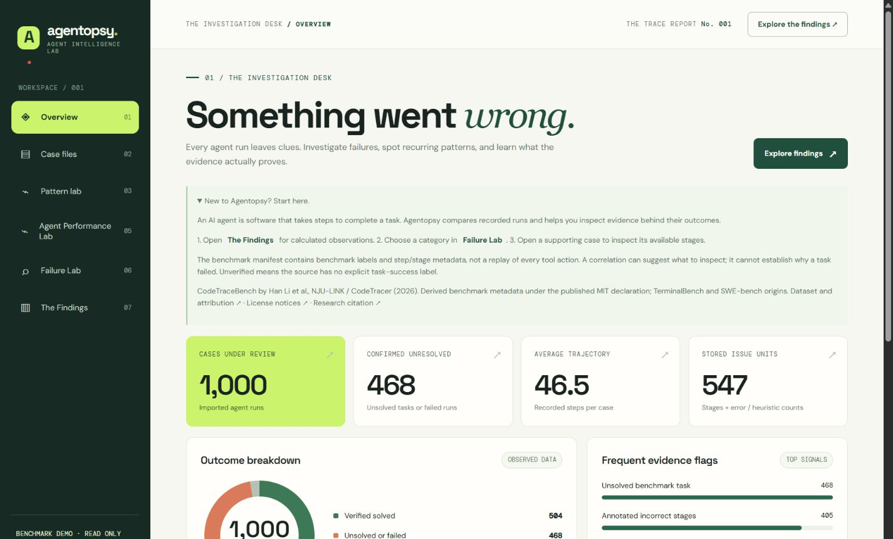

# Agentopsy

**Your AI agent said it's done. But what actually happened?**

An AI agent takes steps to finish a task: running commands, editing files, checking results. Sometimes it gets there. Sometimes it takes the scenic route and still misses the goal.

I built Agentopsy to look through the evidence those runs leave behind. It's an investigation desk for comparing outcomes, following suspicious patterns, and opening the cases behind the numbers. The interesting part is figuring out what the data actually supports.

[Explore the demo](https://agentopsy-demo.onrender.com) · [Run locally](#want-to-run-it-locally) · [Research notes](RESEARCH.md)

## See it in action

**[Open Agentopsy →](https://agentopsy-demo.onrender.com)**



The demo comes with **1,000 real benchmark runs: 504 solved, 468 unsolved, and 28 unverified**. No upload or account needed. It's hosted on Render Free, so the first visit after a quiet spell may take about a minute to wake up.

## So, what does it actually do?

Start at the **Dashboard** for the overall picture. Then open **Case Files** to inspect a run's outcome, recorded length, and available stage summaries. The benchmark metadata gives you clues; it isn't a recording of every action the agent took.

Curious whether one agent did better? **Agent Performance Lab** shows success rates alongside sample sizes, with task categories kept separate. Those 28 unverified runs stay out of the success-rate calculation.

In **Failure Lab**, narrow the selection by agent, category, outcome, or execution length. Follow an evidence flag back to the cases behind it. A long run or an annotated incorrect stage is a reason to look closer, not an automatic diagnosis.

Prefer a starting point? **The Findings** turns calculated observations into short explanations with the actual values, sample sizes, and supporting case links. All calculations use Python and SQL; the explanations come from templates, not an AI model making up a conclusion.

## Here's something interesting

In **software-engineering** tasks, **223 unsolved runs had a median of 40 steps**, compared with **33 steps across 378 solved runs**.

But the pattern doesn't travel everywhere. In **data-science** tasks, the **17 unsolved runs had a median of 34 steps**, while **19 solved runs had a median of 38**.

That's why categories matter. Longer execution can be a useful clue in one group without being a general rule. These are observed associations: task difficulty, agent choice, and other differences could explain them. They don't prove that taking more steps causes failure.

## Try it yourself

1. Open **The Findings** and pick an observation.
2. Explore its category in **Failure Lab** and try a filter.
3. Open a supporting **Case File** to see what evidence is available.

The public demo is read only. Uploads and database changes are disabled. It shows benchmark metadata, not full agent conversations, raw prompts, source code, or personal logs. “Unverified” means the source has no explicit task-success label; it doesn't mean failure.

## Want to run it locally?

Install [Python 3.13](https://www.python.org/downloads/) and [Git](https://git-scm.com/downloads), then open PowerShell:

```powershell
git clone https://github.com/ItszVT/agentopsy.git
cd agentopsy
py -3.13 -m venv .venv
.\.venv\Scripts\python.exe -m pip install -r requirements.txt
.\.venv\Scripts\python.exe -m uvicorn app.main:app --reload --host 127.0.0.1 --port 8765
```

Open [localhost:8765](http://127.0.0.1:8765). No API key needed. A fresh local database starts with **12 clearly labeled synthetic examples**, unlike the real-data public demo. Local mode lets you import supported benchmark manifests or Codex JSONL logs; keep this editable mode on localhost.

To explore the same real benchmark sample as the public demo, stop the server with `Ctrl+C`, then run:

```powershell
.\.venv\Scripts\python.exe -m app.public_demo prepare --download --output data/public-demo-nju.json
$env:AGENTOPSY_MODE = 'demo-preview'
.\.venv\Scripts\python.exe -m uvicorn app.main:app --host 127.0.0.1 --port 8767 --workers 1
```

Open [localhost:8767](http://127.0.0.1:8767). Preparation checks the pinned source's checksum and refuses to overwrite an existing seed file. Preview uses a separate temporary, read-only database, leaving your local cases untouched. To return to editable mode, stop the server and run `Remove-Item Env:AGENTOPSY_MODE` before starting it again.

On macOS/Linux, create the environment with `python3 -m venv .venv`, use `.venv/bin/python` in place of `.\.venv\Scripts\python.exe`, and set preview mode with `export AGENTOPSY_MODE=demo-preview` (`unset AGENTOPSY_MODE` to reset).

Run the automated tests:

```powershell
.\.venv\Scripts\python.exe -m pip install pytest httpx
.\.venv\Scripts\python.exe -m pytest -q
```

## What I used

- **FastAPI and Pydantic** serve the app and validate incoming data; **Uvicorn** runs the server.
- **SQLite** keeps the case metadata in one small database. **Python and SQL** handle the comparisons and descriptive statistics.
- **HTML, CSS, and vanilla JavaScript** power the interface, without a frontend build step.
- **pytest and HTTPX** check imports, calculations, APIs, and the public demo's read-only boundaries.

## What I learned and what's next

The tricky part wasn't drawing charts. It was deciding what a number meant. A missing annotation count isn't zero. An agent finishing its execution isn't proof it solved the task. Fixing those distinctions changed which comparisons were valid.

I'd like to explore better task-matched comparisons, reviewed failure labels, and safe step-level summaries where the source and permissions allow them. For now, Agentopsy helps choose what to investigate. It doesn't independently establish root causes.

## Dataset and research notes

The demo uses derived metadata from the official [NJU-LINK/CodeTraceBench](https://huggingface.co/datasets/NJU-LINK/CodeTraceBench) verified manifest, pinned to revision `aa213b84ffb6690fc37ca15766d6ca174ec36d4d`. Credit goes to **Han Li et al., [CodeTracer: Towards Traceable Agent States (2026)](https://arxiv.org/abs/2604.11641)**.

The publisher declares MIT. Agentopsy's reviewed scope covers the metadata projection, with attribution and [available third-party notices](third_party/NOTICES.txt) retained. It does not imply permission to republish every underlying task, prompt, code file, or raw trajectory.

The sample is selective, runs aren't necessarily unique tasks, and agents may face different task mixes even within a category. Comparisons are exploratory, not a fair leaderboard or a causal experiment.

- [RESEARCH.md](RESEARCH.md): calculations, findings, data corrections, limitations, and reproduction checks.
- [DATASET_LICENSE.md](DATASET_LICENSE.md): source comparison, license evidence, and publication boundaries.
- [DEPLOYMENT.md](DEPLOYMENT.md): seed preparation, startup/restart behavior, and hosting configuration. Its approval notes record the preparation stage; the demo linked above is now live.
- [PORTFOLIO.md](PORTFOLIO.md): the shorter project case study.
